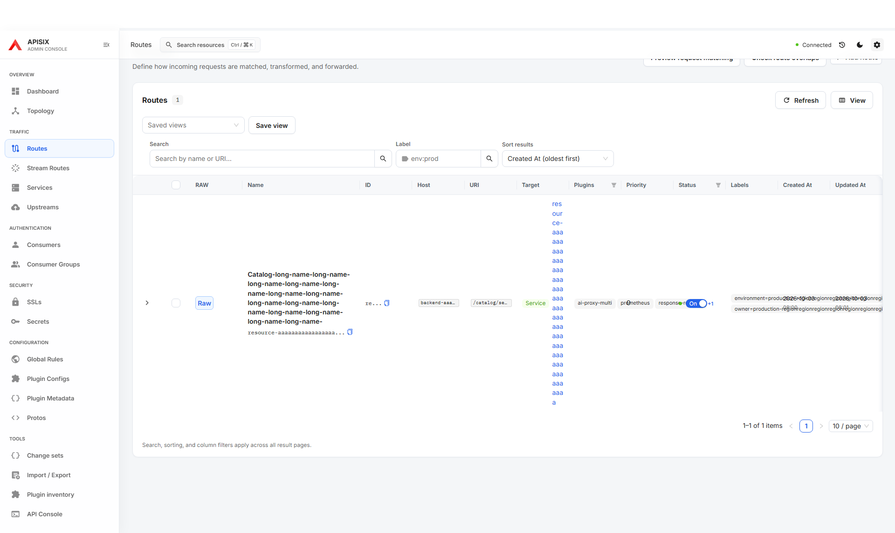
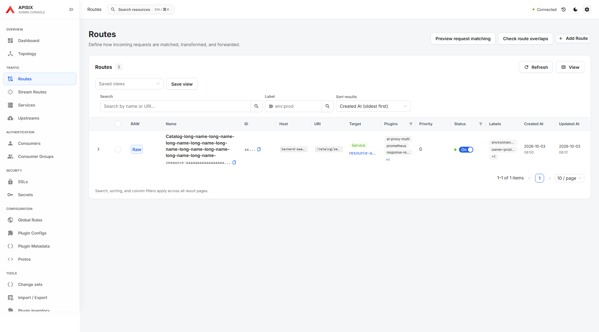
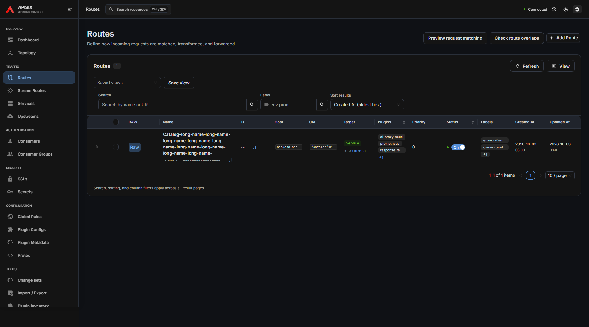
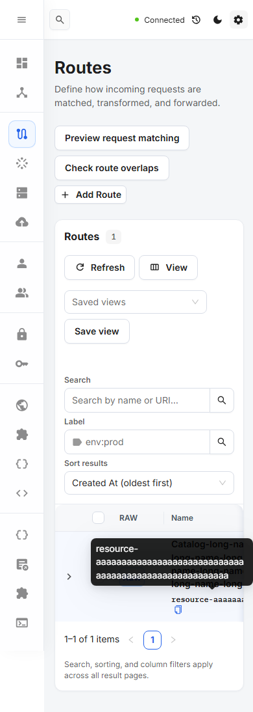

# Resource table cell containment

Long plugin tags and labels could paint over neighboring columns in the fixed-width resource tables. The baseline at master `c35af43a` reproduced eight text/control boundary violations in the Routes fixture, including the displaced Show all plugins action. The same issue reproduced on Stream Routes.

The correction constrains cell children and Space items, permits narrow status/date content to reflow, and wraps the plugin group. Long plugin names, labels and node addresses use compact tags with full-value hover/focus tooltips. Route target IDs and Description values use ellipsis with keyboard access to the full value, avoiding excessively tall rows. Copy ID, links, RAW, plugin expansion and saved table layouts remain available.

## Local validation

- Full ESLint, TypeScript (`tsc -b`) and production build passed.
- `table-cell-overflow.spec.ts` and `table-experience.spec.ts`: **58 passed in 2.7 minutes**, one worker, zero retries.
- Eleven resource lists were checked at 390 px with every optional column enabled and minimum column widths. Painted text and interactive controls are checked against each cell, rather than page overflow alone. Intentional ellipsis is allowed, with separate full-value keyboard assertions.
- Routes additionally covers both themes at 390/1440/1920 px, associated tooltip identity, ID clipboard contents, full plugin lists and row expansion. Long Description focus is checked for Consumers, Consumer Groups and Plugin Configs.
- The new fixtures intercept Admin API reads and abort unexpected writes and off-origin requests. They are presentation/contract checks, not live resource mutation coverage.

```sh
E2E_TARGET_URL=http://127.0.0.1:19243/ui/ pnpm exec playwright test \
  e2e/tests/table-cell-overflow.spec.ts e2e/tests/table-experience.spec.ts \
  --workers=1 --retries=0 --reporter=list
```

## Synthetic evidence

[Before geometry](before-geometry.json) records the original Routes violations. [After geometry](after-geometry.json) records zero violations across eleven lists, with the long-value row-height guard satisfied. The baseline desktop fixture used a longer name; the relevant plugin and label values are unchanged. No row-height reduction percentage is inferred from that image pair.








